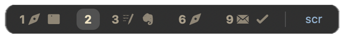

# DinkyHUD
A Hammerspoon spoon HUD for the [dinky window manager from ](https://github.com/mikker/Dinky)

1. Install [`sketchybar-app-font`](https://github.com/kvndrsslr/sketchybar-app-font).
2. ⁣Add the [sketchybar-app-font mapping to the hammerspoon directory](https://github.com/kvndrsslr/sketchybar-app-font)
3. Add the configuration from the `init.lua` to your own.

> [!TIP]
> Add `exec-and-forget /opt/homebrew/bin/hs -c "updateHud()"'` to your mode switch, I think it makes it more responsive.

> [!TIP]
> Place it at the bottom of your screen, hide the dock and set a gap for the outer bottom in dinky (about 40).
